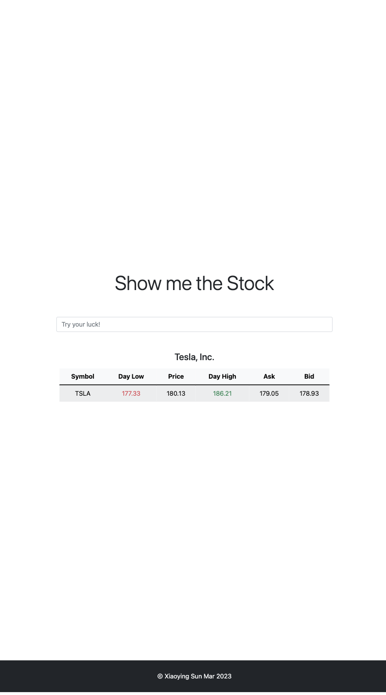

# Show me the Stock

A Spring Boot application and Java client for stock quotes, foreign exchange
rates, and historical prices. The web page lets you search for a stock symbol
and view its price, bid, ask, and daily trading range.

The client is adapted from [YahooFinanceAPI](https://github.com/sstrickx/yahoofinance-api).
Its implementation lives in `com.xiao.yahoofinance`; both the application and
tests use these local classes.

## Java and Gradle

| Component | Version / requirement |
| --- | --- |
| JDK | Java 17 or Java 21; local verification uses Java 21 |
| Java compilation target | Java 17, enforced with `--release 17` |
| Gradle | **8.14.3**, supplied by the committed wrapper |
| Spring Boot | 3.0.4 |
| Lombok | 1.18.30, configured for main and test annotation processing |

Use `./gradlew` instead of a system Gradle installation. The previous wrapper
(7.6.1) and Lombok configuration did not support the installed Java 21 setup.
Gradle supports running on Java 21 from 8.5 onward, and Lombok added JDK 21
support in 1.18.30. See the [Gradle compatibility matrix](https://docs.gradle.org/current/userguide/compatibility.html)
and [Lombok changelog](https://projectlombok.org/changelog).

Check the Java runtime used by the wrapper:

```sh
java -version
./gradlew --version
```

On macOS, select an installed JDK 21 for the current terminal:

```sh
export JAVA_HOME=$(/usr/libexec/java_home -v 21)
export PATH="$JAVA_HOME/bin:$PATH"
```

Java 17 is also a supported build runtime. Set `JAVA_HOME` to its installation
if you use that version. In IntelliJ IDEA, select the wrapper and set the
**Gradle JVM** to JDK 17 or 21. Java 26 is not a supported runtime for this
wrapper and Lombok combination.

## Build and test

```sh
./gradlew clean test
./gradlew build
```

On Windows, use `gradlew.bat clean test` and `gradlew.bat build`.

The first build needs internet access to download Gradle, plugins, and Maven
dependencies. Once those dependencies are cached, run:

```sh
./gradlew clean test --offline
```

All automated tests use local MockWebServer endpoints and committed CSV/JSON
fixtures. They do not request live Yahoo Finance data, so stock price changes,
authentication, and external API availability do not determine test results.

The normal `test` task includes:

- CSV stock and FX quotes, refresh behavior, and historical prices in
  `src/test/java/mock`.
- Exchange time zones, JSON stock quotes, and CSV historical interval requests
  in `src/test/java/yahoofinance`.
- JSON quote and historical chart integration tests in
  `src/integration-test/java`, including missing symbols and incomplete data.

Each test class runs in a separate JVM because the client reads endpoint URLs
and feature flags into static fields when its classes initialize. Mock servers
start before the tests and shut down afterward. Unknown fixture requests return
HTTP 404 instead of crashing the dispatcher.

Local verification on Java 21: **39 tests passed, zero failures or skipped tests**,
and `./gradlew clean build --offline --no-daemon` completed successfully.

Open the generated report at `build/reports/tests/test/index.html`.

## Run the application

```sh
./gradlew bootRun
```

Open [localhost:8080](http://localhost:8080/) and search for a symbol such as
`TSLA`, `SHEL`, or `AIR.PA`. The application itself requests Yahoo Finance;
the local mock endpoints are used only by the tests.

A live lookup depends on the upstream endpoints and their authentication
requirements. Passing fixture tests verifies the local client behavior, but
is not a live API availability check. The legacy CSV URLs are retained for
compatibility tests; the original project documents them as decommissioned.




## Project structure

```text
src/main/java/com/xiao/yahoofinance/  Client, domain objects, and Spring Boot app
src/main/resources/templates/       Thymeleaf search page
src/main/resources/static/          Styles and screenshots
src/test/java/                      Unit tests and local HTTP tests
src/test/resources/                 CSV fixtures and request mappings
src/integration-test/java/          JSON endpoint integration tests
src/integration-test/resources/     JSON fixtures
```

The application excludes datasource auto-configuration and does not require a
local database. The SQL file under `src/main/resources/db` is not executed by
the current application.

## Client configuration

Endpoints and feature flags are Java system properties. Set them **before**
initializing the client; changing them afterward does not reconfigure the
static fields.

| Property | Default | Purpose |
| --- | --- | --- |
| `yahoofinance.quotesquery1v7.enabled` | `true` | Use JSON quotes instead of legacy CSV quotes |
| `yahoofinance.histquotes2.enabled` | `true` | Use CSV download history in `Stock.getHistory()` |
| `yahoofinance.histquotesquery2v8.enabled` | `true` | Use JSON charts in `YahooFinance.getHistQuotes()` |
| `yahoofinance.connection.timeout` | `10000` | Connect and read timeout in milliseconds |
| `yahoofinance.baseurl.quotesquery1v7` | Yahoo query1 quote URL | JSON quote endpoint |
| `yahoofinance.baseurl.histquotes2` | Yahoo query1 download URL | CSV historical endpoint |
| `yahoofinance.baseurl.histquotesquery2v8` | Yahoo query2 chart URL | JSON historical endpoint |

Test fixtures include synthetic regional quote records and historical snapshots;
they are examples for testing, not current market data.
